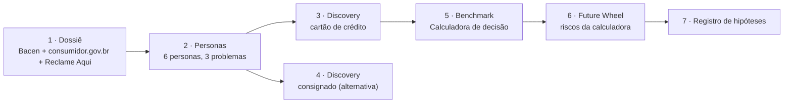

# Discovery a partir de dados: reclamações de clientes PF de bancos brasileiros

Estudo do **Estúdio de IA** para descobrir, a partir de dados públicos, quais problemas os clientes pessoa física de bancos brasileiros registram, quem são essas pessoas e onde há oportunidade de produto.

O resultado é uma hipótese de solução, a **Calculadora da fatura contestada**, com benchmark, riscos mapeados e um registro de hipóteses a validar. O formato final do produto é decisão do grupo.

> **Leia com este viés:** todas as fontes medem insatisfação **registrada**, não insatisfação real.
> Análise realizada em 19/10/2026; documentação em 21/10/2026.

**📄 Página de resultados e hipóteses:** [thaynapfreire.github.io/Est-dio-de-IA](https://thaynapfreire.github.io/Est-dio-de-IA/) (o arquivo é o [`index.html`](index.html)).

---

## O que foi feito



| Etapa | Skill usada | Documento |
|---|---|---|
| 1. Dossiê: o que os dados revelam (3 fontes, separadas) | [`analise-publico-por-dados`](skill-analise-publico-por-dados.md) (Fase A) | [01-dossie-fase-a.md](01-dossie-fase-a.md) |
| 2. Personas emergentes dos problemas A, B e C | [`analise-publico-por-dados`](skill-analise-publico-por-dados.md) (Fase B) | [02-personas-fase-b.md](02-personas-fase-b.md) |
| 3. Discovery de cartão: empatia, jornada, oportunidades | [`discovery-a-partir-de-dados`](skill-discovery-a-partir-de-dados.md) | [03-discovery-cartao.md](03-discovery-cartao.md) |
| 4. Discovery de consignado (alternativa) | [`discovery-a-partir-de-dados`](skill-discovery-a-partir-de-dados.md) | [04-discovery-consignado.md](04-discovery-consignado.md) |
| 5. Benchmark da calculadora + taxas públicas | [`kickoff-dados`](skill-kickoff-dados.md) | [05-benchmark-calculadora.md](05-benchmark-calculadora.md) |
| 6. Future Wheel dos riscos | modelo trazido pelo grupo | [06-future-wheel-riscos.md](06-future-wheel-riscos.md) |
| 7. Hipóteses a validar | — | [07-hipoteses.md](07-hipoteses.md) |

Também: [metodologia e limitações](metodologia-e-limitacoes.md) · [fontes](fontes.md) · [dados](dados.md)

---

## Principais resultados

| | Resultado | Fonte |
|---|---|---|
| 1 | **Cartão de crédito** é o motivo nº 1 de reclamação procedente no Bacen: 5.365 no 2T26, **+47%** no trimestre | Bacen, Ranking de Reclamações 2T26 |
| 2 | **Consignado** somado é o maior tema no Bacen: **6.787** procedentes (irregularidade + informação inadequada) | Idem |
| 3 | **Responder não é resolver:** 93,9% das reclamações respondidas, só **37,5%** das avaliadas resolvidas | consumidor.gov.br, ago/2026 |
| 4 | **Incumbentes pioram:** índice agregado dos privados tradicionais **58,6** contra 27,1 dos digitais e 26,5 dos públicos | Bacen 2T26, cálculo próprio |
| 5 | **"Cobrança indevida"** é o problema nº 1 nos 6 bancos consultados | Reclame Aqui (não oficial), abr–set/2026 |
| 6 | Nenhum dos 6 simuladores de banco verificados conecta **contestação e pagamento**, embora o CDC (art. 54-G, I) permita pagar só a parte não contestada | Benchmark, 19/10/2026; TJDFT |
| 7 | As **taxas médias por banco** (rotativo, parcelado) são públicas no BC; a taxa de cada cliente não | BC, dados abertos |

**Problema escolhido:** cobranças no cartão que a pessoa não reconhece ou não entende, sem contestação bem-sucedida.
**Personas:** A1 (jovem de baixa renda, susto com juros) e A2 (adulto que usa o cartão como orçamento, susto com cobrança).
**Momento crítico:** Fase 4 da jornada, **pagar a fatura com a contestação ainda aberta**.
**Hipótese de solução:** Calculadora da fatura contestada. Pergunta primeiro se o banco foi avisado 10 dias antes; depois mostra o custo de cada caminho, com fonte.
**Riscos altos:** regra do art. 54-G mal aplicada; exposição de dado pessoal.

---

## Arquivos do repositório

Todos os arquivos ficam na raiz, sem pastas.

| Grupo | Arquivos |
|---|---|
| Visão geral | `README.md` · `index.html` (página de resultados) |
| Documentação por etapa | `01-dossie-fase-a.md` a `07-hipoteses.md` |
| Apoio | `metodologia-e-limitacoes.md` · `fontes.md` · `dados.md` |
| Skills usadas | `skill-analise-publico-por-dados.md` · `skill-discovery-a-partir-de-dados.md` · `skill-kickoff-dados.md` |
| Dados (CSV) | `bacen_ranking_top15_2t26.csv` · `bacen_motivos_top5_2t26.csv` · `consumidor_gov_totais_2026.csv` · `consumidor_gov_temas_ago26.csv` · `consumidor_gov_bancos_jun26.csv` · `reclame_aqui_abr_set26.csv` |
| Cálculos | `reproduzir_calculos.py` |
| Configuração | `.gitignore` |

## Página de resultados online

No repositório, vá em **Settings → Pages**, em *Source* escolha **Deploy from a branch**, branch **main**, pasta **/ (root)**, e salve. Em alguns minutos a página abre em `https://thaynapfreire.github.io/Est-dio-de-IA/`. No plano gratuito, o Pages exige repositório público.

## Como reproduzir os cálculos

Baixe o repositório e, na pasta, rode:

```bash
python reproduzir_calculos.py
```

Só usa a biblioteca padrão do Python 3.8+.

## Como usar as skills

Os arquivos `skill-*.md` são instruções para o Claude, em Markdown com frontmatter (`name` e `description`). Para usar em outro setor:

1. **[`analise-publico-por-dados`](skill-analise-publico-por-dados.md)** — mapeia um público a partir de dados públicos; as personas emergem dos dados. Pede setor e restrições de fonte.
2. **[`discovery-a-partir-de-dados`](skill-discovery-a-partir-de-dados.md)** — a partir de um problema e personas já escolhidos, faz persona → jornada → oportunidades.
3. **[`kickoff-dados`](skill-kickoff-dados.md)** — monta um dossiê de mercado com benchmark e gaps, com fonte em cada dado.

Para instalar como skill, o arquivo precisa se chamar `SKILL.md` dentro de uma pasta com o nome da skill.

## Limitações

- Números do consumidor.gov.br e parte dos números do Bacen são de segunda mão (compilações jornalísticas); conferência nos CSVs oficiais pendente.
- Sem demografia do reclamante de bancos em 2026; personas usam o perfil de quem usa crédito.
- Bradesco, BB e Caixa ficaram fora do benchmark (páginas não carregaram).
- Detalhes em [metodologia e limitações](metodologia-e-limitacoes.md).

## Próximos passos

1. Validar H11 (Fase 4 é crítica) e H16 (a calculadora muda a decisão) em entrevistas com A1 e A2.
2. Validar a aplicação do art. 54-G com especialista.
3. Atualizar com o Ranking BC do 3T26 (não encontrado até 21/10/2026).
4. Processar os CSVs do consumidor.gov.br para obter a demografia do reclamante.

---

Análise conduzida com apoio do Claude (Anthropic). As conclusões são ponto de partida qualificado; as decisões são do grupo.
