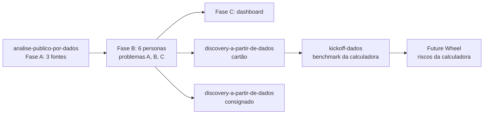

# Metodologia, regras e limitações

## Regras seguidas (instruções do projeto)

1. Só dados públicos. Fontes oficiais: Ranking de Reclamações do Bacen e dados abertos do consumidor.gov.br.
2. Reclame Aqui só como fonte complementar e não oficial, por consulta a páginas públicas. Sem extração em massa ou raspagem.
3. Números de fontes oficiais e não oficiais nunca são somados ou misturados; são comparados lado a lado.
4. Sem dado sensível ou privado de cliente.
5. Nunca "melhor banco". Usar "entre os bancos com dados públicos disponíveis, o que apresenta melhor X é...".
6. Sem números, nomes ou citações inventados. Sem evidência: "não tenho dado suficiente".
7. O formato do produto é decisão do grupo.

## Convenções

- **[DADO] / [D]:** está na fonte citada.
- **[INFERÊNCIA] / [I]:** leitura da análise, a validar.
- Cada afirmação com número traz fonte e período.

## Fluxo

## Limitações estruturais

| Limitação | Efeito |
|---|---|
| Fontes medem insatisfação **registrada** | Quem não conhece ou não usa os canais fica invisível |
| Bacen conta só reclamações **procedentes**, extrapoladas de amostra | Fricção que não viola norma não aparece |
| Categorias do BC são regulatórias | Nomeiam a norma, não o sintoma vivido |
| consumidor.gov.br: CSVs brutos não acessados | Números de segunda mão; demografia ausente |
| Reclame Aqui: público autosselecionado, nota depende da resposta da empresa | Não comparável em nível com as fontes oficiais |
| Personas usam perfil de quem usa crédito | Hipótese H7 |
| Divisão INSS × CLT é de 2025 | Pode ter mudado em 2026 |
| Bradesco, BB e Caixa fora do benchmark | Gap de mercado parcialmente verificado |

## Correções feitas durante a documentação

Ao reproduzir os cálculos a partir dos CSVs (`reproduzir_calculos.py`), duas leituras da análise original foram corrigidas:

| Onde | Antes | Depois |
|---|---|---|
| Reclame Aqui, "voltariam" vs solução | "3 a 12 pontos abaixo" | **3,3 a 15,5 pontos** (o C6 tem 15,5) |
| Reclame Aqui, tempo de resposta × solução | "correlação ~0,6" | **ρ = −0,60** (mais tempo, menos solução) |

Outra correção já feita na conversa: o título completo da matéria da Forbes/Reuters de 13/04/2026 é "BC Vê 'Problema Crescente' de Superendividamento e Aponta Disparada em Empréstimos sem Garantia e Cartão de Crédito".

## Monitoramento e critérios de atualização

| O quê | Frequência | Critério para atualizar o dossiê |
|---|---|---|
| Ranking BC (bancos) | Trimestral (3T26 previsto para o fim de out/2026; não encontrado em 21/10/2026) | Top 3 mudar ou motivo variar mais de 20% no trimestre |
| consumidor.gov.br | Mensal | Mudança no top 3 de assuntos ou na taxa de resolução > 5 p.p. |
| Taxas de juros por instituição (BC) | Semanal | Sempre, se a calculadora for construída |
| Reclame Aqui (6 páginas) | Mensal | Mudança de reputação ou do problema principal |
| Páginas de simuladores dos bancos | Trimestral | Algum banco passar a citar contestação ou art. 54-G |
| Teto do CNPS (consignado INSS) | A cada decisão do CNPS | Sempre |
